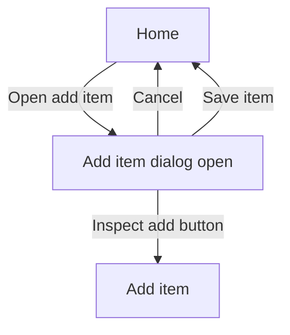

# Screen Workflow File

A workflow file describes a user journey for one Screen using a Mermaid flowchart. Store it as `screens/<screen-id>/workflows/<workflow-id>.mmd`. Workflows are Screen-scoped diagrams; they are not executable interaction logic.

The Studio parses and renders the Mermaid source in the workflow editor. Use **Diagram** and **Source** to switch between the rendered flow and its Mermaid text. Invalid Mermaid is surfaced in the editor and blocks saving.

Use Mermaid `click` directives to link nodes to the Screen preview. Preview links identify the Screen file and use query parameters for the optional placement and state. Node labels are display text and do not determine their link target:

- `click <node-id> href "specux://screen/<screen-id>/screen.yml"` selects a Screen and shows its Default state.
- Add `?placement=<placement-id>` to select a placement and `&state=<state-id>` to select a named preview state. For example, `specux://screen/home/screen.yml?placement=dialog-save&state=add-item-open`.

Clicking a linked node updates the Screen preview above the diagram. Nodes without a SpecUX `click` link remain in the diagram but do not change the preview. Use node IDs as the `click` target; the visible label can be any descriptive text.

Link to a workflow from the behavior spec using a regular Markdown link. The reference may appear anywhere in the spec; the Studio associates it with the workflow node named by `node` and adds a separate spec icon to that node:

```md
[Save item](specux://screen/<screen-id>/workflows/<workflow-id>.mmd?node=<node-id>)
```

Clicking the spec icon shows the Markdown file in the workflow preview panel, hides the canvas rulers and zoom controls, and scrolls to the link's enclosing section. The up/down section selector remains visible in the preview header; it is disabled when there is only one matching section. Moving between linked sections does not change the node's Screen preview link.

Use Mermaid flowcharts to describe user journeys and branches. Normative behavior and acceptance criteria remain in the linked Screen or Element behavior specs; do not duplicate those requirements in the workflow.


