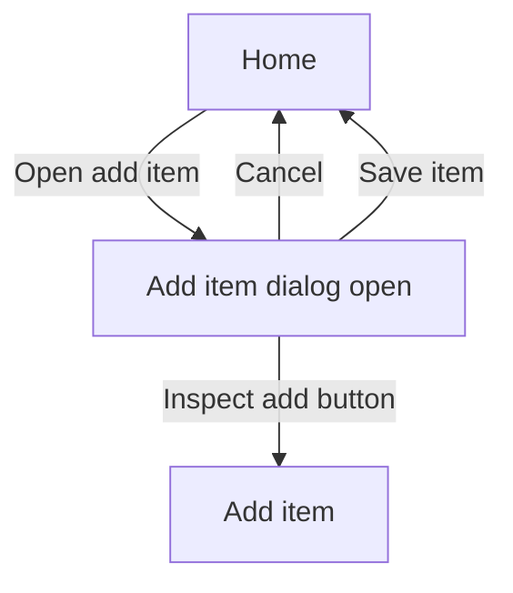

# Screen Workflow File

A workflow file describes a user journey for one Screen using a Mermaid flowchart. Store it as `screens/<screen-id>/workflows/<workflow-id>.mmd`; Screen and workflow IDs begin with a lowercase letter and contain only lowercase letters, numbers, and hyphens. Workflows are Screen-scoped diagrams; they are not executable interaction logic.

The Studio parses and renders the Mermaid source in the workflow editor. Use **Diagram** and **Source** to switch between the rendered flow and its Mermaid text. Invalid Mermaid is surfaced in the editor and blocks saving.

Use Mermaid `click` directives to link nodes to the Screen preview. Preview links identify the Screen file and use query parameters for the optional placement and state. Node labels are display text and do not determine their link target:

- `click <node-id> href "specux://screen/<screen-id>/screen.yml"` selects a Screen and shows its Default state.
- Add `?placement=<placement-id>` to select a placement and `&state=<state-id>` to select a named preview state. For example, `specux://screen/home/screen.yml?placement=dialog-save&state=add-item-open`.

Clicking a linked node updates the Screen preview above the diagram. Nodes without a SpecUX `click` link remain in the diagram but do not change the preview. Use node IDs as the `click` target; the visible label can be any descriptive text.

The Screen preview in the workflow editor is read-only. The placement targeted by the selected node is highlighted for reference, but cannot be selected, moved, resized, rotated, rearranged, or edited from the inspector.

Link to a workflow from the behavior spec using a regular Markdown link. The reference may appear anywhere in the spec; the Studio associates it with the workflow node named by `node` and adds a separate spec icon to that node:

```md
[Save item](specux://screen/<screen-id>/workflows/<workflow-id>.mmd?node=<node-id>)
```

Spec references are represented by one standalone checkmark per workflow node. Show a circular affordance only while the pointer hovers over the link or while its spec preview is selected. Clicking it shows the linked Markdown files in the workflow editor's dedicated spec preview surface, separate from the Screen canvas preview. When multiple files are linked, a bordered file selector switches to the first reference in the chosen file; keep it visually distinct from the bordered reference navigation control. The up/down selector traverses all references in file order, wrapping from the last reference to the first and vice versa, and highlights the current section and link; it is disabled when there is only one reference. Moving between linked sections or files does not change the node's Screen preview link.

Use Mermaid flowcharts to describe user journeys and branches. Normative behavior and acceptance criteria remain in the linked Screen or Element behavior specs; do not duplicate those requirements in the workflow.

Strongly encourage an optional description-and-notes header at the top of each workflow. Put concise plain-text context between `---` delimiters to explain the flow's purpose and any implementation guidance that may help an AI or developer. This is documentation, not a workflow node or requirement; it is not required.


