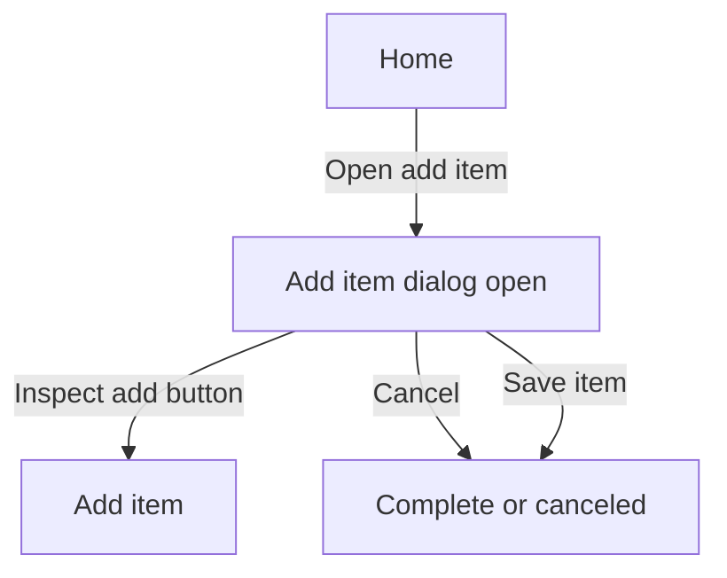

# Screen Workflow File

A workflow file describes a user journey for one Screen using a Mermaid flowchart. Store it as `screens/<screen-id>/workflows/<workflow-id>.mmd`; Screen and workflow IDs begin with a lowercase letter and contain only lowercase letters, numbers, and hyphens. Workflows are Screen-scoped diagrams; they are not executable interaction logic.

The Studio parses and renders the Mermaid source in the workflow editor. Use **Diagram** and **Source** to switch between the rendered flow and its Mermaid text. Invalid Mermaid is surfaced in the editor and blocks saving.

Use Mermaid `click` directives to link nodes to the Screen preview. A link identifies its Screen and includes at least one `placement` query parameter. Repeat `placement` in the same URL to focus several placements on that Screen and state. An omitted `state` means Default; node labels are display text and do not determine their link target:

- Add `?placement=<placement-id>` to select a placement and `&state=<state-id>` to select a named Screen State. To target a placement inside one or more groups, use a dot-separated path from the outermost group to the target, such as `specux://screen/home/screen.yml?placement=dialog.actions.save&state=add-item-open`. Existing single placement IDs remain supported.
- Repeat the key for multiple targets, such as `specux://screen/home/screen.yml?placement=dialog.title&placement=dialog.actions.save&state=add-item-open`. All targets in one URL share the same Screen and normalized state.

The Studio selects the first node with no incoming directed arrows, using Mermaid vertex source order (including nodes first introduced by an edge). Multiple entry points produce a warning while retaining the first; if every node has an incoming directed arrow, the Studio warns and does not guess an entry point.

Missing placement links, Screen-only or state-only links, unresolved targets, and incompatible or duplicate link directives produce non-destructive warnings. The current canvas Screen and focus remain unchanged unless the complete target set resolves. These warnings do not remove or rewrite the workflow source and do not make an otherwise valid Mermaid graph unsavable. Invalid Mermaid syntax remains an error and blocks saving.

Grouping or ungrouping placements updates each repeated workflow placement reference to keep it attached to the same placement. If an ungrouped link targets the group itself, only that `placement` parameter is removed while the remaining targets, Screen, and state context are preserved.

Clicking a node with a valid target set updates the Screen preview above the diagram, highlights all target placements, and fits their combined bounds in the visible canvas. Nodes without a valid placement target remain in the diagram; selecting them displays a warning without changing the existing canvas focus. Use node IDs as the `click` target; the visible label can be any descriptive text.

The Screen preview in the workflow editor is read-only. The placement targeted by the selected node is highlighted for reference, but cannot be selected, moved, resized, rotated, rearranged, or edited from the inspector.

Link to a workflow from the behavior spec using a regular Markdown link. The reference may appear anywhere in the spec; the Studio associates it with the workflow node named by `node` and adds a separate spec icon to that node:

```md
[Save item](specux://screen/<screen-id>/workflows/<workflow-id>.mmd?node=<node-id>)
```

Spec references are represented by one standalone checkmark per workflow node. Show a circular affordance only while the pointer hovers over the link or while its spec preview is selected. Clicking it shows the linked Markdown files in the workflow editor's dedicated spec preview surface, separate from the Screen canvas preview. When multiple files are linked, a bordered file selector switches to the first reference in the chosen file; keep it visually distinct from the bordered reference navigation control. The up/down selector traverses all references in file order, wrapping from the last reference to the first and vice versa, and highlights the current section and link; it is disabled when there is only one reference. Moving between linked sections or files does not change the node's Screen preview link.

Use Mermaid flowcharts to describe user journeys and branches. Normative behavior and acceptance criteria remain in the linked Screen or Element behavior specs; do not duplicate those requirements in the workflow.

Strongly encourage an optional description-and-notes header at the top of each workflow. Put concise plain-text context between `---` delimiters to explain the flow's purpose and any implementation guidance that may help an AI or developer. This is documentation, not a workflow node or requirement; it is not required.


